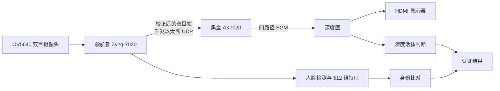

# 双板双目深度人脸认证系统

**AMD Zynq-7020 双板协同 · 双目深度活体检测 · 人脸身份认证 · Vivado / Vitis 2026.1**

本项目使用两块 Zynq-7020 FPGA 开发板完成一套可离线运行的人脸认证系统。系统不仅判断“这个人是谁”，还会利用双目摄像头计算面部深度，用于区分真人与平面照片。整个过程不依赖云端：摄像头采集、深度计算、人脸检测、特征提取、身份比对和显示均在两块开发板上完成。

如果你是第一次接触 FPGA，可以先阅读“[三分钟看懂系统](#三分钟看懂系统)”和“[第一次使用从这里开始](#第一次使用从这里开始)”。如果你要从源码重新构建，请直接进入[零基础复现教程](docs/reproduction.md)。

---

## 三分钟看懂系统

### 两块板分别做什么

|板卡|在系统中的角色|主要任务|你能看到的结果|
|---|---|---|---|
|领航者 Zynq-7020|采集与认证主板|采集双目图像、校正图像、人脸检测、特征提取、身份比对、按键和拍摄交互|串口认证日志、按键响应、拍摄结果|
|黑金 ALINX AX7020|深度计算与显示板|接收校正后的双目数据、执行四路径 SGM 深度计算、生成深度图、驱动 HDMI 显示|显示器上的深度图和十字叉丝|

两块板通过千兆以太网直连。领航者发送双目图像，AX7020 返回并显示深度结果。两块板必须同时运行，单独启动其中一块不能得到完整功能。



### 系统解决了什么问题

- **身份认证**：检测人脸并提取 512 维特征，与已登记人员进行比对。
- **照片攻击防护**：双目深度用于判断目标是否具有真实三维结构，降低平面照片冒充风险。
- **实时深度显示**：AX7020 持续输出深度图，十字叉丝可通过按键移动。
- **双板分工**：把认证与深度计算拆到两块 Zynq-7020 上，减轻单板资源和带宽压力。
- **离线运行**：不需要互联网、云服务器或 PC 参与推理。

---

## 已验证结果

以下数据均来自工程包中的原始实现报告、仿真记录和板端日志。详细口径见[资源与性能汇总](reports/summary.md)。

### 资源与时序

|指标|领航者 Zynq-7020|黑金 ALINX AX7020|
|---|---:|---:|
|Slice|11,787 / 13,300（88.62%）|8,695 / 13,300（65.38%）|
|LUT|36,672 / 53,200（68.93%）|24,063 / 53,200（45.23%）|
|寄存器|51,420 / 106,400（48.33%）|25,053 / 106,400（23.55%）|
|BRAM Tile|121 / 140（86.43%）|115 / 140（82.14%）|
|DSP|96 / 220（43.64%）|0 / 220（0%）|
|WNS|**+0.325 ns**|**+0.618 ns**|

两块板的建立、保持和脉宽检查均无失败端点。正 WNS 表示当前约束下的实现通过时序；它不等同于所有板外接口都已完成实验室级时序签核，相关边界见[报告说明](reports/summary.md)。

### 功能与性能

|项目|实测或验证结果|如何理解|
|---|---:|---|
|持续深度更新|27.9271 帧/秒|约 139 秒有效窗口内，接收、深度计算和显示更新保持同速率|
|现场身份认证|10 / 10 准入|10 次复测均身份匹配并准入；属于小样本功能验证，不代表 FAR/FRR|
|身份推理耗时|平均 2.6915 秒|人脸检测与特征提取合计|
|完整人脸模型同帧验证|124 个整数算子、512 维特征逐位一致|证明所测帧的板端整数计算与独立参考一致|
|SGM 路径核验证|4,244 组输入、275,860 个候选输出一致|验证 AX7020 使用的路径核逻辑|
|人脸加速器验证|297 例、695,964 字节整数输出一致|独立整数参考与优化 C++ 实现一致|

> 源端为保持低延迟会主动舍弃过期帧。实测主动舍弃比例为 2.315%，这不是以太网丢包率；有效统计窗口内相关网络异常计数增量为 0。

---

## 第一次使用从这里开始

根据你的目的选择一条路线，不必一上来就重编整个工程。

|你的目的|推荐路线|是否需要开发板|是否需要 Vivado / Vitis|
|---|---|---:|---:|
|只想检查工程包是否完整|运行交付校验|否|否|
|想直接演示已经验证的版本|使用 `board/` 中的稳定镜像|是|JTAG 下载需要 Vitis；SD 启动不需要 PC 工具|
|想验证算法结果|运行 `sim/` 下的离线测试|否|部分测试需要 Vivado 或 Vitis HLS|
|想重新编译两板软件和启动镜像|运行全软件源码重建|否|需要 Vitis 2026.1|
|想连 FPGA 硬件也从零实现|运行完整硬件重建|否，构建完成后上板验收才需要|需要 Vivado / Vitis 2026.1|

### 1. 解压并放到短英文路径

不要直接在压缩包中运行，也不要放在中文或很深的目录中。推荐复制到：

```text
F:\amd_stereo_2026_1
```

当你看到下面这些内容时，所在目录就是“工程根目录”：

```text
README.md
project_config.json
src\
build\
board\
reports\
```

### 2. 先做不连接开发板的完整性检查

打开 PowerShell，进入工程根目录：

```powershell
Set-Location 'F:/amd_stereo_2026_1'
python ./scripts/verify_delivery.py
python ./ski11/scripts/selftest.py
```

第一条命令的最终结果应包含 `"passed": true`，表示源码、稳定镜像、构建记录和清单配对正确。第二条命令检查随包提供的报告解析与校验工具。两条命令都不会连接或修改开发板。

### 3. 要直接上板演示

- 已完成双板联调的文件位于 `board/navigator/` 和 `board/ax7020/`。
- JTAG 下载入口是 `build/scripts/run_board.py`；脚本默认只显示计划，只有加入 `--execute` 才真正下载。
- SD 卡启动使用各板 `board/<板卡>/sd/BOOT.BIN`，两块板的 `BOOT.BIN` 不能互换。
- 推荐先启动 AX7020，再启动领航者；移动同一根 JTAG 下载线时，必须再次确认当前连接的是哪块板。
- 详细接线、命令、成功现象和故障排查见[零基础复现教程：上板运行](docs/reproduction.md#路线-a直接运行稳定版最快看到结果)。

### 4. 要从源码重新构建

请按[零基础复现教程](docs/reproduction.md)依次完成：

1. 检查 Python 和 AMD 2026.1 工具；
2. 在新目录中执行离线验证；
3. 重建两板 BSP、lwIP、CPU1、CPU0、FSBL 和 BOOT.BIN；
4. 用 Vivado 重新创建、综合、实现两块板硬件；
5. 检查资源、时序、DRC、bit 和 XSA；
6. 将新硬件与新软件配套封装；
7. 最后再做 JTAG 或 SD 冷启动验收。

---

## 硬件与软件准备

### 硬件

- 领航者 Zynq-7020 开发板；
- 黑金 ALINX AX7020 开发板；
- 正点原子 OV5640 双目摄像头，接领航者 J4；
- 7 英寸 RGB LCD/HDMI 显示链路（以当前工程实物连接为准）；
- 两块板之间的千兆网线；
- JTAG 下载器；
- 两根 USB-UART 串口线；
- 两张 SD 卡（采用 SD 启动时）；
- 两块板各自可靠供电。

### 软件

- Windows 10/11；
- AMD Vivado 2026.1，安装 Zynq-7000 器件支持；
- AMD Vitis 2026.1，包含 ARM 裸机 GCC、make、Bootgen 和 XSDB；
- Python 3（包内检查脚本只使用标准库）；
- 可选串口工具，用于查看两块板运行日志。

> 本工程统一以 2026.1 为主版本。不要混用 2022.2 或其他版本生成的 BSP、FSBL、XSA、bit 和应用 ELF。

---

## 系统连接与网络参数

|项目|领航者|AX7020|
|---|---|---|
|角色|图像采集与认证|深度计算与显示|
|默认 IP|`192.168.7.10`|`192.168.7.20`|
|数据通道|与 AX7020 直连|与领航者直连|
|UDP 端口|`5001`|`5001`|

检查顺序：

1. 两块板分别供电；
2. 摄像头接领航者，显示器接 AX7020；
3. 两板网口用网线直连；
4. 两根 USB-UART 接电脑并记录各自 COM 号；
5. 先启动 AX7020，再启动领航者；
6. 观察网口灯、双串口日志和显示器深度图；
7. 最后测试十字叉丝移动键和拍摄认证键。

若显示器只有十字叉丝、没有深度图，通常说明显示逻辑已经运行，但双目帧没有完整到达深度链路。优先检查两板程序是否配套、网线链路、启动顺序和串口中的 peer/帧计数，不要先怀疑显示器。

---

## 工程目录怎么读

```text
.
├── README.md                 # 本页：项目介绍与入口
├── project_config.json       # 两板源码、BSP、链接脚本和嵌入数据的统一配置
├── src/                      # 两板 RTL、HLS、PS 软件、BSP、IP、XDC 和依赖源码
│   ├── navigator/            # 领航者板硬件与软件
│   ├── ax7020/               # AX7020 板硬件与软件
│   └── common/               # 两板共用标定、模型和数据
├── build/scripts/            # 重建、实现、封装和下板脚本
├── board/                    # 已完成联调的稳定 bit、ELF、FSBL、BOOT.BIN 和初始化文件
├── validation_candidates/    # 2026.1 全源码重建后的候选产物，与稳定版分开放置
├── sim/                      # 测试台、黄金参考、输入和预期输出
├── reports/                  # 综合、实现、HLS、性能及复核报告
├── data/                     # 板端原始日志、同帧数据和实测统计
├── docs/                     # 复现、交付范围和全源码重建说明
├── scripts/                  # 交付完整性检查脚本
├── ski11/                    # 可复用的项目代码技能包和校验脚本
├── collaboration/            # 精选大模型协作记录
├── metadata/                 # 来源映射与版本边界
└── manifest.json             # 全包文件大小和 SHA-256 清单
```

### 稳定版与候选版的区别

- `board/`：已完成双板联调的稳定镜像，演示时优先使用。
- `validation_candidates/`：从源码重新构建并封装的候选物，用于复现和回归验证。
- 新生成的文件应写入新的输出目录，不要直接覆盖以上两个目录。

---

## 从零复现入口

完整教程见 **[docs/reproduction.md](docs/reproduction.md)**。教程把复现拆成四条路线：

1. **路线 A：直接运行稳定版**——最快看到深度图和认证结果；
2. **路线 B：离线算法验证**——不接板，检查 SGM、人脸加速器和身份判定；
3. **路线 C：软件全源码重建**——重新生成 BSP、网络库、双核应用、FSBL 和 BOOT.BIN；
4. **路线 D：硬件也从零重建**——使用 Vivado 重建两块板工程、综合、实现并生成 bit/XSA。

每一步都给出了：需要什么、执行哪条命令、成功时会看到什么、失败后先查哪里。

---

## 资源优化说明

领航者迁移后的初始实现使用 13,120 个 Slice（98.65%）。优化后为 11,787 个（88.62%），减少 1,333 个 Slice，下降 10.03 个百分点，并保持 8 路并行和原定点算法不变。主要措施为：

- 将四组参数缓存从分布式逻辑迁移到 BRAM；
- 将限定域内的步长乘法改写为数值等价移位；
- 对高密度逻辑使用紧凑的 CLB 布局范围；
- 重新执行实现并同时检查资源、时序、DRC 和上板功能。

代价是 BRAM 从 106 块增加到 121 块，但 Slice 降到 90% 以下，DSP、LUT、寄存器和 BRAM 均未超过 90%。原始报告和数值等价验证分别位于 `evidence/` 与 `sim/hls/`。

---

## 正确性是怎样确认的

本工程没有用单一截图代替验证，而是按层次保存证据：

1. **模块级**：SGM 路径核、人脸加速器和身份判定与独立参考逐项比较；
2. **模型级**：同一真实帧覆盖 YuNet、MobileFaceNet 共 124 个整数算子，比较 512 维特征；
3. **软件级**：两板源码在 2026.1 下重新编译和链接；
4. **硬件级**：保留两板综合、实现、资源、时序和 DRC 原始报告；
5. **系统级**：保存双串口日志、持续深度帧率、认证耗时和异常计数；
6. **启动级**：保存 JTAG 运行文件和 SD 冷启动镜像及清单。

证据索引见[赛事交付内容索引](docs/submission_requirements.md)。

---

## 常见问题

### 1. 为什么运行脚本提示找不到文件？

先确认当前目录直接包含 `project_config.json`。如果路径含中文、空格过多或层级太深，请把整个工程复制到 `F:/amd_stereo_2026_1` 后重试。

### 2. 为什么 Vivado 重新实现后的资源或 WNS 与报告略有不同？

布局布线受工具种子、机器环境和并行执行影响，不保证 bit 文件逐字节一致。验收时应同时检查功能、资源上限、WNS/TNS、失败端点和 DRC，而不是只比较一个数字。

### 3. 为什么显示器只有十字叉丝，没有深度图？

这通常不是 HDMI 模块完全失效，而是 AX7020 没有持续收到有效双目帧。检查两板程序是否来自同一版本、网线灯、两板 IP/端口、启动顺序和串口计数。

### 4. 为什么换了新 ELF 后帧率下降？

主应用依赖 `-O3` 以及部分预览模块的 NEON 编译选项。使用 IDE 默认低优化配置会降低帧率。应使用包内脚本和 `build_options.json`，不要手工改成默认 Debug 配置。

### 5. 新生成的 bit、FSBL 和 ELF 可以随意混用吗？

不可以。XSA、bit、FSBL、BSP 和应用 ELF 必须来自兼容的硬件与软件接口。新构建请放在独立目录中，完成 JTAG 回归后再封装 SD 镜像。

更多排错方法见[零基础复现教程：常见故障](docs/reproduction.md#常见故障与排查顺序)。

---

## 文档导航

|内容|入口|
|---|---|
|零基础完整复现|[docs/reproduction.md](docs/reproduction.md)|
|软件、驱动、双核应用与 FSBL 全源码重建细节|[docs/full_source_rebuild_2026_1.md](docs/full_source_rebuild_2026_1.md)|
|资源、时序和性能汇总|[reports/summary.md](reports/summary.md)|
|持续运行与认证实测|[reports/live_measurement_20261101.md](reports/live_measurement_20261101.md)|
|完整人脸模型同帧验证|[reports/full_model_same_frame_20261101.md](reports/full_model_same_frame_20261101.md)|
|赛事交付内容索引|[docs/submission_requirements.md](docs/submission_requirements.md)|
|项目代码技能包|[ski11/README.md](ski11/README.md)|
|精选大模型协作记录|[collaboration/selected_dialogue.html](collaboration/selected_dialogue.html)|

---

## 版本与验证边界

- 主版本统一为 **Vivado / Vitis 2026.1**。
- 原始工具报告中的日期和绝对路径只用于追溯，不是新电脑上的运行入口。
- 完整模型同帧比较证明所测帧的部署计算与参考一致，不代表多身份、多姿态、多光照和多攻击类型的统计准确率。
- 10 次认证是现场功能复测，不应表述为 FAR、FRR 或大规模准确率。
- `manifest.json` 用于检查交付文件是否缺失或被修改；清单一致不等同于算法和硬件功能已经自动通过。

